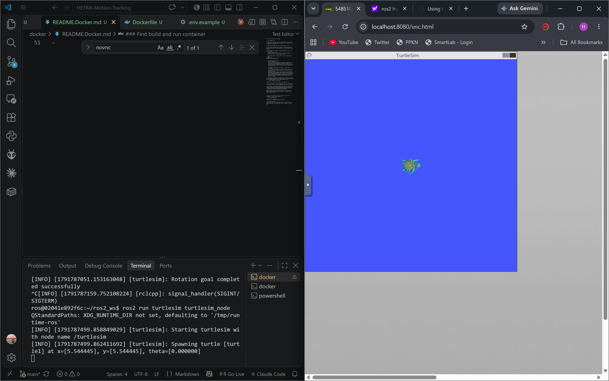

### First build and run container
0. If you are unfamiliar with Docker, please start by watching this YouTube video: [Docker Short Tutorial](https://youtu.be/DQdB7wFEygo?si=kHUkx7uFuL76zd9X). 
    Install docker using the instructions from that video (you might need to restart your computer after installing docker dekstop). In a terminal, run: `docker --version`.
    It should give you something like: `Docker version xx.x.x`

1. Start docker dekstop. Even though we will be using docker CLI, we need to start docker dekstop to start the docker engine (daemon).

2. Build image, first build is large and takes a while. In a terminal, run:
    `docker compose build` 
    You only need to rebuild docker if anything changes in `./Dockerfile` and `../docker-compose.yaml`

    You should get this message once it's built successfully:
```bash
[+] build 1/1
✔ Image ros2-dev:latest Built 
```

3. Start the container. Run:    
    `docker compose up -d`.        
    The -d flag is for detaching the container aka running the container in the background. If you want to ommit this, leave the terminal running docker open. In that case you should start a new terminal for running other commands.

    The compose file defines two services, so you get two containers:
    - ros is your ROS 2 Humble environment. This is where you run ``docker compose exec ros bash`` and where your code builds and runs.
    - novnc is a small virtual screen that shows the windows of GUI tools like turtlesim, rviz2, and rqt in your browser at http://localhost:8080/vnc.html. It runs as its own container so the display works the same on Windows, Mac, and Linux. Without this, any ros application with a GUI won't run.

4. Go into your container's terminal. This is where you can run ros2 commands (because ros2 is installed only inside your container, not your host machine!). In your host terminal, run:
    `docker compose exec ros bash`.

    When you want to exit the ros terminal, just run: `exit`.

5. Start browser GUI. Go to your browser and paste this into the search bar: ``http://localhost:8080/vnc.html``. Click connect.

6. Learn ROS2 :) Start here: [ROS2 First Tutorial](https://docs.ros.org/en/humble/Tutorials/Beginner-CLI-Tools/Introducing-Turtlesim/Introducing-Turtlesim.html)

    A few notes:
    - I have put in turtlesim, RQT, and RVIZ inside the Dockerfile, so they are installed in your ros container already.
    - I have made a shell script so that you don't need to source ros everytime you open a terminal inside your container.
    - For EVERY GUI used (turtlesim, RQT, RVIZ), open the GUI browser page to see the actual interface. I recommend using split screen like this.
    
    - When you want to make your own nodes, launch files, or anything that you want to run inside the container, put them under `../ros2_ws/src`. 

7. When you are done for the day and want to close the container, exit your ros terminal so that you're in your host terminal instead. Then, run:
    `docker compose down --remove--orphans`

# Other useful commands:
`docker ps` -> list all containers running

# Some common issues:
- Low disk space. The desktop ROS layer is several GB, and Docker keeps the build cache and the final image at the same time.
- 
